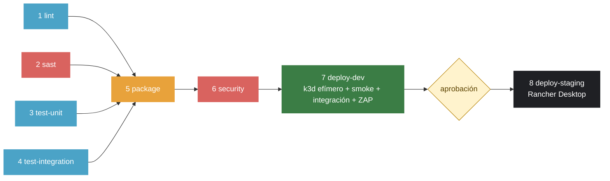

# demo-cicd: libro de visitas con pipeline CI/CD (LAB-04)

[](https://github.com/KrisD08/demo-cicd/actions/workflows/ci-cd.yml)

Curso IF-1116, Tópicos de Tecnologías de Información, 2026-II. Aplicación de tres servicios (`web` nginx, `api` Node.js, `db` Postgres) con un pipeline de GitHub Actions de punta a punta: lint, SAST y secretos, pruebas unitarias y de integración, imágenes escaneadas, DEV efímero en Kubernetes, DAST y promoción a STAGING con aprobación manual.

## El pipeline



| # | Etapa (job) | Herramienta | Qué revisa | Si falla | Evento |
|---|---|---|---|---|---|
| 1 | `lint` | ESLint, HTMLHint, Hadolint | JavaScript, HTML y los tres Dockerfiles | No se publica nada | PR y push a `main` |
| 2 | `sast` | Semgrep `1.180.0`, TruffleHog `3.99.4` | Patrones inseguros en código/config y secretos en todo el historial | No se publica nada | PR y push a `main` |
| 3 | `test-unit` | Vitest, Supertest, jsdom | API con pool falso y el sitio estático | No se publica nada | PR y push a `main` |
| 4 | `test-integration` | Vitest + Docker Compose | La aplicación completa entrando por `web` | No se publica nada | PR y push a `main` |
| 5 | `package` | Buildx, GHCR | Construye y publica `demo-cicd-{web,api,db}:sha-<commit>` | No hay imagen que escanear | PR y push a `main` |
| 6 | `security` | Trivy | `CRITICAL,HIGH` con corrección disponible, por imagen | Nada llega a DEV | PR y push a `main` |
| 7 | `deploy-dev` | k3d `v5.9.0`, kubectl, ZAP `2.17.0` | Despliegue en clúster efímero, smoke, integración y DAST | No hay aprobación a STAGING | Solo push a `main` |
| 8 | `deploy-staging` | Runner propio, kubectl | Promueve **la misma imagen** a Rancher Desktop | Staging queda como estaba | Solo push a `main`, espera aprobación |

Un PR nunca despliega. Cada run deja un resumen (`$GITHUB_STEP_SUMMARY`) con resultados de pruebas, vulnerabilidades por severidad y lo que se está aprobando. Una versión secuencial, la de la guía, está en [`docs/baseline/ci-cd-baseline.yml`](docs/baseline/ci-cd-baseline.yml).

## Correrlo en tu máquina

```bash
cp .env.example .env          # y cambia la contraseña
docker compose up -d --build --wait
open http://localhost:8080    # en Windows: start http://localhost:8080
```

```bash
npm ci && npm ci --prefix api
npm run lint
npm run test:unit             # pruebas unitarias de la API
npm run test:site             # pruebas del sitio
npm run test:integration      # contra http://localhost:8080 (la app tiene que estar levantada)
bash scripts/smoke.sh http://localhost:8080
```

## La API

| Método y ruta | Qué hace | Respuesta |
|---|---|---|
| `GET /api/health` | Dice si el servicio está sano | `200` `{"status":"ok"}`, o `503` si no hay base de datos |
| `GET /api/mensajes` | Lista los mensajes, el más reciente primero | `200` con un arreglo JSON |
| `GET /api/estadisticas` | Cuenta los mensajes (B4) | `200` `{"total": N}` |
| `POST /api/mensajes` | Crea un mensaje `{"nombre","mensaje"}` | `201`, o `400` si falta un campo o el mensaje pasa de 280 caracteres |
| `GET /metrics` | Métricas de Prometheus | Solo dentro de la red; nginx devuelve `404` desde afuera |

## B3: rómpelo por etapa

| Etapa | Qué rompí | Run en rojo | Run en verde | Minuto de detección |
|---|---|---|---|---|
| `lint` | <PENDIENTE> | <PENDIENTE: enlace> | <PENDIENTE: enlace> | <PENDIENTE> |
| <PENDIENTE: etapa> | <PENDIENTE> | <PENDIENTE: enlace> | <PENDIENTE: enlace> | <PENDIENTE> |
| <PENDIENTE: etapa> | <PENDIENTE> | <PENDIENTE: enlace> | <PENDIENTE: enlace> | <PENDIENTE> |
| <PENDIENTE: etapa> | <PENDIENTE> | <PENDIENTE: enlace> | <PENDIENTE: enlace> | <PENDIENTE> |

## B6: antes y después

"Antes" = primer run completo en verde con `docs/baseline/ci-cd-baseline.yml`. "Después" = `ci-cd.yml` actual. No incluye la espera de la aprobación.

| Job | Antes | Después |
|---|---|---|
| lint | <PENDIENTE> | <PENDIENTE> |
| sast | <PENDIENTE> | <PENDIENTE> |
| test-unit | <PENDIENTE> | <PENDIENTE> |
| test-integration | <PENDIENTE> | <PENDIENTE> |
| package | <PENDIENTE> | <PENDIENTE> |
| security | <PENDIENTE> | <PENDIENTE> |
| deploy-dev | <PENDIENTE> | <PENDIENTE> |
| deploy-staging | <PENDIENTE> | <PENDIENTE> |
| **Total del run** | <PENDIENTE> | <PENDIENTE> |

Qué se cambió para acelerar: `lint`, `sast`, `test-unit` y `test-integration` corren en paralelo (antes eran una cadena); `package` espera a los cuatro, así que la compuerta es la misma; solo `linux/amd64` (sin QEMU ni `arm64`); `concurrency` cancela runs viejos de un PR; caché de capas de Docker y de npm.

## Bitácora de decisiones

### B2: Herramientas cambiadas

- **Decisión:** TruffleHog en lugar de Gitleaks (secretos) y k3d en lugar de kind (clúster efímero de DEV).
- **Alternativas que evalué:** <PENDIENTE: al menos dos por cambio, con pros y contras>
- **Por qué elegí esta:** <PENDIENTE>
- **Fuentes consultadas:** <PENDIENTE: enlaces>
- **Cómo lo verifiqué:** <PENDIENTE: enlace al run en verde y al run en rojo de cada una>
- **Qué no me funcionó:** <PENDIENTE>

### Reto 1: DAST con OWASP ZAP

- **Decisión:** ZAP baseline `2.17.0` dentro de `deploy-dev`, contra DEV; cabeceras de seguridad en `web/nginx.conf`; alertas aceptadas en `.zap/rules.tsv`.
- **Alternativas que evalué:** <PENDIENTE>
- **Por qué elegí esta:** <PENDIENTE>
- **Fuentes consultadas:** <PENDIENTE>
- **Cómo lo verifiqué:** <PENDIENTE: enlace al run con el reporte>
- **Qué no me funcionó:** <PENDIENTE>

### Reto 2: GitLab CI

- **Decisión:** `.gitlab-ci.yml` con `test`, `build` y `deploy` manual.
- **Alternativas que evalué:** <PENDIENTE> · **Por qué elegí esta:** <PENDIENTE> · **Fuentes:** <PENDIENTE>
- **Cómo lo verifiqué:** <PENDIENTE: enlace al pipeline en GitLab> · **Qué no me funcionó:** <PENDIENTE>

| GitHub Actions | GitLab CI |
|---|---|
| `.github/workflows/ci-cd.yml` | `.gitlab-ci.yml` |
| `on:` (pull_request, push) | `rules:` / `workflow:rules` |
| `jobs:` + `needs:` | `stages:` + jobs (`needs:` opcional) |
| `runs-on: ubuntu-latest` | runners compartidos; `image:` por job |
| `uses: actions/...` | `image:`, `include:` y `script:` |
| `strategy.matrix` | `parallel: matrix:` |
| `secrets.GITHUB_TOKEN` | `$CI_REGISTRY_USER` / `$CI_REGISTRY_PASSWORD` |
| `ghcr.io/<usuario>/...` | `$CI_REGISTRY_IMAGE` |
| `github.sha` | `$CI_COMMIT_SHA` / `$CI_COMMIT_SHORT_SHA` |
| `environment:` con revisores | `when: manual` (o `environment:` + entornos protegidos) |
| `actions/upload-artifact` | `artifacts:` |
| Servicio Docker del runner | `services: [docker:dind]` |

### Reto 3: Observabilidad en STAGING

- **Decisión:** Prometheus y Grafana con manifiestos propios en `k8s/observabilidad/` (sin Helm), alerta `TasaDeErrores5xxAlta` (> 5 % durante 1 min).
- **Alternativas que evalué:** <PENDIENTE: p. ej. kube-prometheus-stack> · **Por qué elegí esta:** <PENDIENTE> · **Fuentes:** <PENDIENTE>
- **Cómo lo verifiqué:** <PENDIENTE: capturas del dashboard y de la alerta disparada> · **Qué no me funcionó:** <PENDIENTE>
- **¿Qué métrica agregaría para saber si la base se vuelve lenta?** <PENDIENTE: tu respuesta>

### Reto 4: GitOps con Argo CD

- **Estado:** <PENDIENTE: no intentado / intentado; ver `retos/r4-argocd/`>
- **Pregunta de la defensa, ¿qué gano y qué pierdo cuando el pipeline ya no toca el clúster?** <PENDIENTE: tu respuesta>

### Reto 5: Ambiente con URL pública

- **Decisión:** GKE Autopilot con Workload Identity Federation (OIDC, sin claves en GitHub); carpeta `retos/r5-gke/`. URL: <PENDIENTE: URL pública>. Alternativa preparada: Render, en `retos/r5-render/`.
- **Alternativas que evalué:** Render (deploy hooks sin vencimiento, API expuesta), Koyeb (no pude confirmar su red interna). <PENDIENTE: tus pros y contras>
- **Por qué elegí esta:** <PENDIENTE> · **Fuentes:** <PENDIENTE: enlaces a la documentación de Google Cloud que uses>
- **Cómo lo verifiqué:** <PENDIENTE: enlace al run>
- **Qué no me funcionó:** <PENDIENTE>

### Reto 6: Terraform

- **Decisión:** `terraform/` con el provider `integrations/github`: ruleset de `main` y ambientes `dev` y `staging`.
- **Alternativas que evalué:** <PENDIENTE: Ansible para el runner> · **Por qué elegí esta:** <PENDIENTE> · **Fuentes:** <PENDIENTE>
- **Cómo lo verifiqué:** <PENDIENTE: salida de `terraform plan`> · **Qué no me funcionó:** <PENDIENTE>

## Estructura

```
web/ api/ db/           los tres servicios (Dockerfiles endurecidos con apk upgrade)
tests/                  unit, site, integration
scripts/                smoke.sh, desplegar.sh, resumen-vitest.mjs, resumen-trivy.mjs
k8s/                    base, overlays (dev, staging) y observabilidad (R3)
.github/                workflows/ci-cd.yml y dependabot.yml
.zap/rules.tsv          alertas de ZAP aceptadas, con su porqué (R1)
.gitlab-ci.yml          R2
retos/r4-argocd/        R4 (alternativa de deploy-staging)
retos/r5-gke/           R5 (URL pública en GKE con OIDC)
retos/r5-render/        R5, alternativa en Render
terraform/              R6
docs/baseline/          el pipeline de la guía, para medir el "antes" (B6)
compose.yaml            la app en tu máquina, con perfil opcional de observabilidad
```

