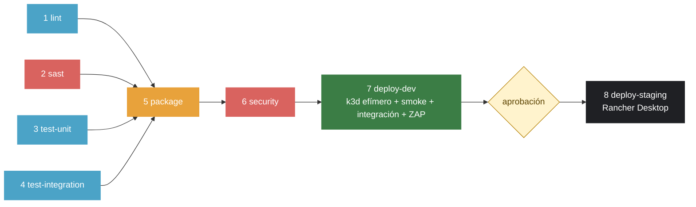

# demo-cicd: libro de visitas con pipeline CI/CD (LAB-04)

[](https://github.com/KrisD08/demo-cicd/actions/workflows/ci-cd.yml)

Curso IF-1116, Tópicos de Tecnologías de Información, 2026-II. Aplicación de tres servicios (`web` nginx, `api` Node.js, `db` Postgres) con un pipeline de GitHub Actions de punta a punta: lint, SAST y secretos, pruebas unitarias y de integración, imágenes escaneadas, DEV efímero en Kubernetes, DAST y promoción a STAGING con aprobación manual.

Paquetes: [`demo-cicd-web`](https://github.com/KrisD08?tab=packages&repo_name=demo-cicd), `demo-cicd-api` y `demo-cicd-db` (públicos, en GHCR).

## El pipeline



| # | Etapa (job) | Herramienta | Qué revisa | Si falla | Evento |
|---|---|---|---|---|---|
| 1 | `lint` | ESLint, HTMLHint, Hadolint | JavaScript, HTML y los tres Dockerfiles | No se publica nada | PR y push a `main` |
| 2 | `sast` | Semgrep `1.180.0`, TruffleHog `3.99.4` | Patrones inseguros en código/config y secretos en todo el historial | No se publica nada | PR y push a `main` |
| 3 | `test-unit` | Vitest, Supertest, jsdom | API con pool falso y el sitio estático | No se publica nada | PR y push a `main` |
| 4 | `test-integration` | Vitest + Docker Compose | La aplicación completa entrando por `web` | No se publica nada | PR y push a `main` |
| 5 | `package` | Buildx, GHCR | Construye y publica `demo-cicd-{web,api,db}:sha-<commit>` | No hay imagen que escanear | PR y push a `main` |
| 6 | `security` | Trivy | `CRITICAL,HIGH` con corrección disponible, por imagen | Nada llega a DEV | PR y push a `main` |
| 7 | `deploy-dev` | k3d `v5.9.0`, kubectl, ZAP `2.17.0` | Despliegue en clúster efímero, smoke, integración y DAST | No hay aprobación a STAGING | Solo push a `main` |
| 8 | `deploy-staging` | Runner propio, kubectl | Promueve **la misma imagen** a STAGING (Rancher Desktop) | Staging queda como estaba | Solo push a `main`, espera aprobación |

Un PR nunca despliega (en las capturas, los jobs 7 y 8 de un PR salen *omitidos*). Cada run deja un resumen (`$GITHUB_STEP_SUMMARY`) con resultados de pruebas, vulnerabilidades por severidad y lo que se está aprobando. La versión secuencial de la guía está en [`docs/baseline/ci-cd-baseline.yml`](docs/baseline/ci-cd-baseline.yml).

## Correrlo en tu máquina

```bash
cp .env.example .env          # y cambia la contraseña
docker compose up -d --build --wait
open http://localhost:8080    # en Windows: start http://localhost:8080
```

```bash
npm ci && npm ci --prefix api
npm run lint
npm run test:unit             # pruebas unitarias de la API
npm run test:site             # pruebas del sitio
npm run test:integration      # contra http://localhost:8080 (la app tiene que estar levantada)
bash scripts/smoke.sh http://localhost:8080
```

## La API

| Método y ruta | Qué hace | Respuesta |
|---|---|---|
| `GET /api/health` | Dice si el servicio está sano | `200` `{"status":"ok"}`, o `503` si no hay base de datos |
| `GET /api/mensajes` | Lista los mensajes, el más reciente primero | `200` con un arreglo JSON |
| `GET /api/estadisticas` | Cuenta los mensajes (B4) | `200` `{"total": N}` |
| `POST /api/mensajes` | Crea un mensaje `{"nombre","mensaje"}` | `201`, o `400` si falta un campo o el mensaje pasa de 280 caracteres |
| `GET /metrics` | Métricas de Prometheus | Solo dentro de la red; nginx devuelve `404` desde afuera |

## B1: pipeline completo y mandando

- **Pipeline de la guía** corriendo en un PR: lint, SAST, pruebas, integración y las tres imágenes en verde; los jobs 7 y 8 omitidos ([PR #1](https://github.com/KrisD08/demo-cicd/pull/1), run #4, `docs/evidencias/b6-antes-pr-run4-2m16s.png`).
- **Un push a `main` despliega a DEV solo y STAGING espera aprobación** ([run #15](docs/evidencias/b1-run15-espera-aprobacion-staging.png): jobs 1 a 7 en verde, "requested your review to deploy to staging").
- **`main` protegida:** ruleset activo, PR obligatorio y los diez checks de `lint`, `sast`, `test-unit`, `test-integration`, `package` y `security` ([lista](docs/evidencias/b1-ruleset-checks-requeridos.png), [estado](docs/evidencias/b1-ruleset-main-activo.png), [reglas](docs/evidencias/b1-ruleset-reglas.png)). El ruleset también está descrito en `terraform/` (R6).
- **Dependabot** con `cooldown` de 7 días. Abrió PR para npm y Docker ([lista](docs/evidencias/b1-dependabot-prs.png); [pipeline de uno de sus PR](docs/evidencias/b1-dependabot-run10-verde.png)). El [PR #7](https://github.com/KrisD08/demo-cicd/pull/7) (`globals` 15.15.0 → 17.13.0) se mezcló después de pasar por el pipeline con 12 checks en verde ([captura](docs/evidencias/b1-dependabot-pr7-mergeado.png)). En los PR de Dependabot, `package` construye pero no publica y `security` se omite, porque reciben un token de solo lectura.
- **Trivy en `CRITICAL,HIGH`**, sin bajar la severidad ni usar `exit-code: 0`:
  - `api`: Trivy bloqueó por `body-parser` (HIGH) y `qs`; se **actualizaron las dependencias** (`npm audit fix`, 0 vulnerabilidades) en lugar de aceptarlas ([primer run del PR #1, con `api` en rojo](docs/evidencias/b1-trivy-run2-api-rojo-body-parser.png)).
  - `db`: 25 HIGH, todas de la biblioteca estándar de Go dentro del binario `gosu` de la imagen oficial de Postgres ([run #3](docs/evidencias/b1-trivy-run3-db-rojo-gosu.png)). Se **aceptaron una por una en `.trivyignore`**, cada una con su justificación (`gosu` solo cambia de usuario al arrancar y no usa red, TLS, HTTP ni XML).
  - Los tres Dockerfiles ejecutan `apk upgrade --no-cache`; `api` además quita `npm` y `corepack` de la imagen final.
- **STAGING en Rancher Desktop, desplegado por un runner propio** (ver la nota de abajo sobre la laptop):
  - Runner `LAPTOP-HK9LL8N7` (`self-hosted`, `Windows`, `X64`) en [Idle](docs/evidencias/b1-runner-idle.png).
  - Run de `main` [#46](https://github.com/KrisD08/demo-cicd/actions/runs/40634077341) (commit `2e409c2`, merge del PR #25): jobs 1 a 8 en verde, "The deployments have been approved", `8. Deploy STAGING` en 55 s ([captura](docs/evidencias/b1-staging-run46-aprobado.png); el runner lo registró como [Succeeded](docs/evidencias/b1-runner-job8-succeeded.png)).
  - Pods de `demo-staging` con las imágenes `ghcr.io/krisd08/demo-cicd-{api,db,web}:sha-2e409c2…` ([kubectl](docs/evidencias/b1-staging-kubectl-pods.png), [imágenes](docs/evidencias/b1-staging-pods-imagenes.png)). Son las mismas imágenes que pasaron por `security` y DEV.
- **Persistencia:** un mensaje de prueba escrito antes del segundo despliegue ([captura](docs/evidencias/b1-persistencia-mensaje-antes.png)) sigue en la lista después del run #48 del PR #26, commit `24cbab8`, `8. Deploy STAGING` en 47 s ([run](docs/evidencias/b1-staging-run48-segundo-despliegue.png), [captura](docs/evidencias/b1-persistencia-mensaje-despues.png)).
- **Nota sobre dónde corre STAGING:** corre en el Rancher Desktop (k3s `v1.36.5+k3s1`) de **otra laptop** distinta a la mía. En mi laptop, WSL2 no pudo activar la virtualización de Windows: faltaba el servicio `vmcompute` y la descarga del componente por Windows Update se quedaba atascada.
- **Un fallo real de este tramo:** el primer `7. Deploy DEV` falló con `scripts/desplegar.sh: Permission denied` (exit code 126), porque el script perdió el permiso de ejecución al copiarlo. Se corrigió dándole el permiso en Git y llamándolo con `bash scripts/desplegar.sh` desde los workflows ([log](docs/evidencias/b1-error-permiso-desplegar-sh.png), [PR #10](https://github.com/KrisD08/demo-cicd/pull/10)).

## B2: herramientas del menú cambiadas

| Etapa | En la guía | Mi cambio | Versión fija |
|---|---|---|---|
| Secretos | Gitleaks | **TruffleHog** | imagen `trufflesecurity/trufflehog:3.99.4` |
| Clúster efímero de DEV | kind | **k3d** | binario `v5.9.0`, verificado con `sha256sum` |

**Verde:** los runs de PR del pipeline final ([#31](docs/evidencias/b6-despues-pr-run31-1m38s.png), [#33](docs/evidencias/b6-despues-pr-run33-1m41s.png)) y el run de `main` [#34](docs/evidencias/r1-zap-run34-dev-verde-2m14s.png) (`7. Deploy DEV` con k3d en 2 m 14 s).

**Rojo, TruffleHog:** el [run #38](https://github.com/KrisD08/demo-cicd/actions/runs/40628108987) (PR #21, rama `romper/trufflehog2`): el job `2. SAST (Semgrep) y secretos (TruffleHog)` terminó en rojo a los 29 s con un secreto falso y aleatorio ([captura](docs/evidencias/b2-trufflehog-run38-rojo.png)). El primer intento ([PR #20](https://github.com/KrisD08/demo-cicd/pull/20)) usaba una cadena ordenada de baja entropía y TruffleHog **no** la marcó: pasó en verde. TruffleHog revisa todo el historial, así que ese PR no se arregla con un `git revert` y se cerró sin merge.

**Rojo, k3d:** el [run #40](https://github.com/KrisD08/demo-cicd/actions/runs/40628843773) (merge del [PR #22](https://github.com/KrisD08/demo-cicd/pull/22), que cambió el `readinessProbe` a `/api/salud`): `7. Deploy DEV` falló a los 4 m 6 s. El paso "Esperar el rollout" agotó el tiempo (`error: timed out waiting for the condition`, 3 m 31 s) porque el pod de `api` nunca quedó listo ([run](docs/evidencias/b2-k3d-run40-rojo.png), [log](docs/evidencias/b2-k3d-log-rollout-timeout.png)). El [PR #23](https://github.com/KrisD08/demo-cicd/pull/23) lo revirtió ([checks](docs/evidencias/b2-k3d-fix-pr23-run41-verde-1m27s.png)). Un PR no despliega, por eso el PR #22 había pasado todos sus checks ([captura](docs/evidencias/b2-k3d-pr22-checks.png)).

## B3: rómpelo por etapa

"Minuto de detección" = tiempo desde que empezó el run hasta que terminó en rojo, según la pestaña Actions. Cada rama se cerró sin merge.

| Etapa | Qué rompí | Run en rojo | Run en verde | Minuto de detección |
|---|---|---|---|---|
| `lint` | `FROM node` sin tag en `api/Dockerfile` (Hadolint `DL3006`) | [PR #11](https://github.com/KrisD08/demo-cicd/pull/11), run #16 ([captura](docs/evidencias/b3-lint-run16-rojo-26s.png), [checks del PR](docs/evidencias/b3-lint-pr11-checks-rojo.png), [log](docs/evidencias/b3-lint-hadolint-log.png)) | PR #11, run #17 (tras el `revert`) | **26 s** (el job `lint` falló a los 22 s) |
| `test-unit` | En `api/app.js`, `400` por `200` cuando falta el nombre | [PR #12](https://github.com/KrisD08/demo-cicd/pull/12), [run #18](https://github.com/KrisD08/demo-cicd/actions/runs/40619349418) ([captura](docs/evidencias/b3-unit-run18-rojo-32s.png), [log](docs/evidencias/b3-unit-log-assertion.png), [commits del PR: el roto y su `revert`](docs/evidencias/b3-unit-pr12-commits-rojo-y-revert.png)) | [run #19](https://github.com/KrisD08/demo-cicd/actions/runs/40619459296) ([captura](docs/evidencias/b3-unit-run19-verde.png)) | **32 s** (job 3 falló a los 11 s: `expected 200 to be 400`) |
| `test-integration` | En `web/nginx.conf`, `proxy_pass http://api:3001` | [PR #13](https://github.com/KrisD08/demo-cicd/pull/13), [run #20](https://github.com/KrisD08/demo-cicd/actions/runs/40619671427) ([captura](docs/evidencias/b3-integracion-run20-rojo-1m7s.png), [log](docs/evidencias/b3-integracion-log-502.png)) | [run #21](https://github.com/KrisD08/demo-cicd/actions/runs/40619874171) ([captura](docs/evidencias/b3-integracion-run21-job4-verde.png)) | **1 m 07 s** (las unitarias pasaron; `/api/*` devolvió `502`) |
| `security` | `express@4.17.1` con dependencias vulnerables | [PR #15](https://github.com/KrisD08/demo-cicd/pull/15), [run #23](https://github.com/KrisD08/demo-cicd/actions/runs/40620628933) ([captura](docs/evidencias/b3-security-run23-rojo-2m31s.png), [log de Trivy](docs/evidencias/b3-security-trivy-log.png)) | [run #24](https://github.com/KrisD08/demo-cicd/actions/runs/40620953363) ([captura](docs/evidencias/b3-security-run24-verde-2m0s.png)) | **2 m 31 s** (pasó `package`; Trivy bloqueó `path-to-regexp` y `qs`) |

Lo que enseña la tabla: lo barato se detecta temprano. El lint falla en 26 s y no se construye nada; un error de nginx lo detecta la integración en poco más de un minuto, sin llegar a publicar imágenes; el escaneo de seguridad, que necesita las imágenes ya publicadas, tarda 2 m 31 s.

Un intento que no falló: el primer cambio de `security` ([PR #14](https://github.com/KrisD08/demo-cicd/pull/14), `FROM node:16-alpine`) pasó en verde. Trivy escanea los paquetes del sistema y las librerías, no el programa `node` en sí, y mi `apk upgrade` más la eliminación de `npm` dejaron la imagen sin nada que marcar. Para forzar el rojo hubo que usar una dependencia vieja con vulnerabilidades corregibles (PR #15).

## B4: un cambio mío pasa por todo el pipeline

`GET /api/estadisticas` devuelve `{"total": N}` y la página muestra el total junto al título.

- Pruebas: 3 unitarias nuevas (pool falso: total como número, total como texto de Postgres, error 500 sin filtrar detalle), 1 del sitio y 1 de integración (el total sube en uno al crear un mensaje). Total: 12 unitarias y 7 del sitio.
- [PR #16](https://github.com/KrisD08/demo-cicd/pull/16): run #25 con los 6 jobs en verde en 2 m 37 s ([captura](docs/evidencias/b4-pr16-run25-verde-2m37s.png)).
- En STAGING: la página muestra **"Libro de visitas (3 mensajes)"** ([captura](docs/evidencias/b4-libro-de-visitas-total.png)) y los mensajes de prueba ([captura](docs/evidencias/b1-persistencia-mensaje-antes.png)).

## B5: el pipeline se explica solo

- Diagrama y tabla de etapas: arriba. Badge del workflow: arriba.
- Cada run deja un resumen en `$GITHUB_STEP_SUMMARY`. Por ejemplo, la sección "SAST y secretos" se ve en la pestaña Summary del run ([captura](docs/evidencias/b6-despues-pr-run31-1m38s.png)), y el run de despliegue deja la tabla de pods con sus imágenes ([captura](docs/evidencias/r5-gke-run-verde-4m16s.png)).

## B6: antes y después

Medido con los tiempos que muestra la pestaña Actions. "Antes" = el pipeline secuencial de la guía (`docs/baseline/ci-cd-baseline.yml`); "después" = `ci-cd.yml` actual.

**CI, jobs 1 a 6** (un PR; no incluye despliegue ni espera de aprobación):

| Job | Antes (PR #1, run #4) | Después (PR #17, run #31) |
|---|---|---|
| lint | 18 s | 18 s |
| sast | 24 s (Gitleaks) | 29 s (TruffleHog) |
| test-unit | 13 s | 11 s |
| test-integration | 37 s | 34 s |
| package + security (por diferencia, incluye arranque de jobs) | ≈ 68 s | ≈ 64 s |
| **Total del run** | **2 m 16 s** | **1 m 38 s** |

Con el primer run de cada pipeline, el total baja **27.9 %** ((136 − 98) / 136). Con más runs del mismo tipo, el promedio baja **30 %**: antes {2 m 16 s, 2 m 14 s, 2 m 00 s, 2 m 37 s} = 2 m 17 s (runs #4, #14, #24 y #25); después {1 m 38 s, 1 m 41 s, 1 m 27 s} = 1 m 35 s (runs #31, #33 y #41). Capturas: [#4](docs/evidencias/b6-antes-pr-run4-2m16s.png), [#14](docs/evidencias/b6-antes-pr-run14-2m14s.png), [#31](docs/evidencias/b6-despues-pr-run31-1m38s.png), [#33](docs/evidencias/b6-despues-pr-run33-1m41s.png).

**Despliegue a DEV** (solo push a `main`):

| Job | Antes (run #15) | Después (runs #34, #46, #48) |
|---|---|---|
| deploy-dev | 1 m 25 s (kind, sin ZAP) | 2 m 14 s, 2 m 15 s y 2 m 13 s (k3d + ZAP) |
| deploy-staging | n/d | 55 s (run #46), 47 s (run #48) |

Capturas: [run #15](docs/evidencias/b6-antes-main-run15-deploy-dev-1m25s.png), [run #34](docs/evidencias/r1-zap-run34-dev-verde-2m14s.png).

**Alcance de la medición.** La reducción de más del 25 % se logra en la parte de CI (jobs 1 a 6). El job `deploy-dev` pasó de 1 m 25 s a poco más de 2 m porque se le agregó el escaneo ZAP del Reto 1 (el paso de ZAP tardó 56 s en el run #32) y se cambió kind por k3d. Si se suma DEV al total de un run de `main`, el tiempo total no baja el 25 %: la seguridad extra (DAST) cuesta tiempo, y se decidió mantenerla en el camino crítico. El "antes" en `deploy-staging` no existe, porque el pipeline de la guía llegó a STAGING por primera vez cuando ya estaba el pipeline final.

Qué se cambió para acelerar: `lint`, `sast`, `test-unit` y `test-integration` corren en paralelo (antes eran una cadena); `package` espera a los cuatro, así que la compuerta es la misma; solo `linux/amd64` (sin QEMU ni `arm64`); `concurrency` cancela runs viejos de un PR; caché de capas de Docker y de npm.

## Bitácora de decisiones

### B2: Herramientas cambiadas

- **Decisión:** TruffleHog en lugar de Gitleaks (secretos) y k3d en lugar de kind (clúster efímero de DEV).
- **Alternativas que evalué:** para secretos, Gitleaks (la de la guía; revisa el historial con un patrón por regla) y TruffleHog (detectores por tipo de credencial, con filtro de entropía). Para el clúster, kind (la acción `helm/kind-action`) y k3d (k3s dentro de Docker, un solo binario).
- **Por qué elegí esta:** TruffleHog se corre desde su imagen oficial con versión fija y, con `--fail`, cualquier hallazgo (verificado o no) deja el job en rojo, igual que Gitleaks. k3d es un único binario con versión fija (`v5.9.0`) cuyo `sha256` se verifica antes de instalarlo, sin depender de otra acción de terceros.
- **Fuentes consultadas:** https://github.com/trufflesecurity/trufflehog · https://hub.docker.com/r/trufflesecurity/trufflehog/tags · https://github.com/k3d-io/k3d/releases/tag/v5.9.0
- **Cómo lo verifiqué:** runs en verde con ambas herramientas (runs #31, #33 y #34) y runs en rojo a propósito (TruffleHog: run #38; k3d: run #40); ver la sección B2 de arriba.
- **Qué no me funcionó:** el primer secreto de prueba era una secuencia ordenada y TruffleHog no lo detectó (PR #20 en verde); con un valor aleatorio sí (PR #21). Y un `git revert` no sirve para arreglar un PR con un secreto, porque TruffleHog revisa todo el historial.

### Reto 1: DAST con OWASP ZAP

- **Decisión:** ZAP baseline `2.17.0` dentro de `deploy-dev`, contra el DEV efímero; cabeceras de seguridad en `web/nginx.conf`; alertas aceptadas en `.zap/rules.tsv`; el reporte sube como artefacto `reporte-zap`.
- **Alternativas que evalué:** *baseline* (solo análisis pasivo: no escribe datos), *full scan* (ataca activamente, más lento y escribe datos) y *API scan* (necesita una definición OpenAPI que esta app no tiene).
- **Por qué elegí esta:** baseline es pasivo, rápido y no ensucia los datos de DEV, y deja un job en rojo ante cualquier alerta que no esté corregida o aceptada por escrito.
- **Fuentes consultadas:** https://www.zaproxy.org/docs/docker/baseline-scan/
- **Cómo lo verifiqué:** [run #32](https://github.com/KrisD08/demo-cicd/actions/runs/40624417054) en rojo, `FAIL-NEW: 0, WARN-NEW: 9, PASS: 59`, `exit code 2` ([captura](docs/evidencias/r1-zap-run32-rojo.png), [log](docs/evidencias/r1-zap-log-warn.png)). Las 9 alertas: 10009, 10020, 10021, 10036, 10038, 10049, 10063, 10109 y 90004. El [PR #18](https://github.com/KrisD08/demo-cicd/pull/18) corrigió **seis** con cabeceras en nginx (`X-Frame-Options`, `nosniff`, `server_tokens off`, `Content-Security-Policy`, `Permissions-Policy` y `Cross-Origin-Embedder-Policy`) y aceptó **tres**, una por una, con su porqué en `.zap/rules.tsv`: 10009 (la 404 de nginx solo muestra la palabra "nginx"), 10049 (contenido público y estático) y 10109 (alerta informativa). El run de `main` [#34](https://github.com/KrisD08/demo-cicd/actions/runs/40626037233) terminó con `7. Deploy DEV` en verde ([captura](docs/evidencias/r1-zap-run34-dev-verde-2m14s.png)).
- **Qué no me funcionó:** ZAP solo corre en `main`, porque necesita DEV; el primer run salió en rojo después del merge, no en el PR. Y mi `nginx.conf` inicial no traía `Cross-Origin-Embedder-Policy`: faltó hasta que ZAP lo marcó.

### Reto 2: GitLab CI

- **Decisión:** `.gitlab-ci.yml` con `test` (más la plantilla `Security/SAST`), `build` (las tres imágenes al registro de GitLab, etiquetadas con `$CI_COMMIT_SHORT_SHA`) y `deploy` **manual** (levanta las tres imágenes en el servicio Docker del runner y corre `scripts/smoke.sh`).
- **Alternativas que evalué:** `deploy` en un clúster de Kubernetes (necesita un clúster conectado a GitLab) o con un servicio externo; elegí un despliegue efímero con `docker:dind`, que verifica las imágenes recién publicadas sin infraestructura extra.
- **Por qué elegí esta:** funciona con los runners compartidos de gitlab.com y el registro de contenedores de GitLab, sin credenciales de larga duración.
- **Fuentes consultadas:** https://docs.gitlab.com/ee/ci/ · https://docs.gitlab.com/ee/ci/docker/using_docker_build.html
- **Cómo lo verifiqué:** pipeline [#2997395958](https://gitlab.com/KrisD08/demo-cicd/-/pipelines/2997395958): `test` y `build` en verde y `deploy` en espera manual ([captura](docs/evidencias/r2-gitlab-pipeline-deploy-manual.png)); al pulsar ▶, el job `deploy` terminó en **Passed** en 38 s con los cinco `OK` del smoke test ([captura](docs/evidencias/r2-gitlab-deploy-smoke-verde.png)). La imagen se descargó de `registry.gitlab.com/krisd08/demo-cicd/web:7386a2c0`.
- **Qué no me funcionó:** el primer `git push` a GitLab fue rechazado con `shallow update not allowed` (el clon del Codespace era superficial); se arregló con `git fetch --unshallow origin`. Además, la pantalla de tokens *fine-grained* de GitLab tiene muchos permisos separados y no era claro cuál permitía hacer `push`. Terminé usando un **token clásico** con alcance `write_repository`, más simple de acotar que los permisos separados del token *fine-grained*.

| GitHub Actions | GitLab CI |
|---|---|
| `.github/workflows/ci-cd.yml` | `.gitlab-ci.yml` |
| `on:` (pull_request, push) | `rules:` / `workflow:rules` |
| `jobs:` + `needs:` | `stages:` + jobs (`needs:` opcional) |
| `runs-on: ubuntu-latest` | runners compartidos; `image:` por job |
| `uses: actions/...` | `image:`, `include:` y `script:` |
| `strategy.matrix` | `parallel: matrix:` |
| `secrets.GITHUB_TOKEN` | `$CI_REGISTRY_USER` / `$CI_REGISTRY_PASSWORD` |
| `ghcr.io/<usuario>/...` | `$CI_REGISTRY_IMAGE` |
| `github.sha` | `$CI_COMMIT_SHA` / `$CI_COMMIT_SHORT_SHA` |
| `environment:` con revisores | `when: manual` (o `environment:` + entornos protegidos) |
| `actions/upload-artifact` | `artifacts:` |
| Servicio Docker del runner | `services: [docker:dind]` |

### Reto 3: Observabilidad en STAGING

- **Decisión:** Prometheus (`v3.1.0`) y Grafana (`11.4.0`) con manifiestos propios en `k8s/observabilidad/` (sin Helm), en el mismo clúster de STAGING. Prometheus descubre los pods de `demo-staging` por las anotaciones `prometheus.io/*`, con un `Role` mínimo en ese namespace. Dashboard RED y alerta `TasaDeErrores5xxAlta`: más del 5 % de respuestas 5xx durante 1 minuto.
- **Alternativas que evalué:** el chart `kube-prometheus-stack` de Helm (completo, con Alertmanager, pero con muchos componentes) frente a manifiestos propios (pocos objetos, fáciles de explicar y de revisar).
- **Por qué elegí esta:** manifiestos propios porque caben en dos archivos y el lab pide poder explicar cada línea; la alerta vive en una regla de Prometheus.
- **Fuentes consultadas:** https://prometheus.io/docs/prometheus/latest/configuration/configuration/ (`kubernetes_sd_configs`) · https://prometheus.io/docs/prometheus/latest/configuration/alerting_rules/
- **Cómo lo verifiqué:** Prometheus con el grupo `api-staging` **2 / 2 UP** ([captura](docs/evidencias/r3-prometheus-targets-up.png)); dashboard "Libro de visitas: métricas RED" con tráfico real ([captura](docs/evidencias/r3-grafana-dashboard.png)); al escalar `db` a 0 réplicas la alerta pasó a **PENDING** (valor 0.127) ([captura](docs/evidencias/r3-alerta-pending.png)) y después a **FIRING** (valor 0.714, activa desde hacía 1 m 8 s) ([captura](docs/evidencias/r3-alerta-firing.png)). Luego restauré `db` a 1 réplica.
- **Qué no me funcionó:** la primera prueba la hice demasiado rápido (apliqué los manifiestos, generé tráfico y apagué la base en segundos, antes de que Prometheus estuviera listo) y no registró nada; hubo que repetirla esperando a que los pods estuvieran `Running`. Además escribí comandos mientras un bucle ocupaba la terminal, y quedaron en cola.
- **¿Qué métrica agregaría para saber si la base se vuelve lenta?** Un histograma de la duración de cada consulta a Postgres (por tipo de consulta), y un contador de errores y de esperas del pool de conexiones. Así se ve la lentitud de la base antes de que la API empiece a devolver 5xx.
### Reto 4: GitOps con Argo CD

- **Estado:** no implementado. El material de referencia está en `retos/r4-argocd/` (`Application`, el `kustomization.yaml` con `images:` y el job `deploy-staging` que haría `commit` del tag).
- **Pregunta de la defensa, ¿qué gano y qué pierdo cuando el pipeline ya no toca el clúster?** Gano: el estado deseado queda en Git (auditable, con historial), el rollback es un `git revert`, el agente corrige cambios hechos a mano (*self-heal*) y el pipeline no necesita credenciales del clúster. Pierdo: hay un paso más (y una latencia) entre el commit y el despliegue, el pipeline necesita permiso para escribir en `main` (que está protegida, así que requiere una excepción), y los secretos tienen que seguir fuera de Git.
### Reto 5: Ambiente con URL pública

- **Decisión:** GKE Autopilot con Workload Identity Federation (OIDC): el workflow `deploy-gke.yml` se lanza a mano con el SHA de un commit de `main`, pide un token OIDC y Google lo cambia por credenciales temporales, sin ninguna clave en GitHub. Despliega las **mismas imágenes** de GHCR (`k8s/overlays/publico`, `web` detrás de un `LoadBalancer`).
- **Alternativas que evalué:** Render (plan gratuito; los *deploy hooks* son URL secretas sin vencimiento, no hay OIDC, y un servicio gratuito no recibe tráfico privado, así que la API quedaría expuesta) y Koyeb (no pude confirmar su red interna ni la imagen desde registros públicos). Dejé armada la alternativa de Render en `retos/r5-render/`.
- **Por qué elegí esta:** es la única que cumple "sin una clave de larga duración": la federación solo acepta tokens de este repositorio **y** de un job con el ambiente `publico` (condición `assertion.repository=='KrisD08/demo-cicd' && assertion.environment=='publico'`).
- **Fuentes consultadas:** https://cloud.google.com/iam/docs/workload-identity-federation · https://github.com/google-github-actions/auth · https://cloud.google.com/kubernetes-engine/docs/concepts/autopilot-overview
- **Cómo lo verifiqué:** run [`Deploy público (GKE)`](https://github.com/KrisD08/demo-cicd/actions/runs/40636228961): primer intento en rojo; luego en verde en 4 m 16 s ([captura](docs/evidencias/r5-gke-run-verde-4m16s.png)) y en 47 s ([captura](docs/evidencias/r5-gke-run-verde-47s.png)). El resumen muestra la URL `http://35.226.232.85`, el commit `2e409c2…` y los tres pods (`api`, `db`, `web`) con `LISTO true` y las imágenes `ghcr.io/krisd08/demo-cicd-*:sha-2e409c2…`. El PR del workflow es el [#25](docs/evidencias/r5-pr25-checks.png). Configuración de identidad: pool `github`, proveedor `github-repo`, cuenta de servicio `gha-deploy` con `roles/container.developer` y `roles/iam.workloadIdentityUser` solo para este repositorio. La condición de atributos del proveedor, antes (`repository` y `sub`) y después de restringirla por ambiente (`repository` y `environment`), se ve en esta [captura de Cloud Shell](docs/evidencias/r5-wif-condicion-atributos.png).
- **Qué no me funcionó:** (1) el primer ID de proyecto fue rechazado por contener "palabras prohibidas" y mis cuatro proyectos viejos no tenían facturación, así que creé uno nuevo y lo vinculé a la cuenta de educación; (2) el script de configuración falló la primera vez porque la API de Kubernetes aún no se había propagado (`has not been used in project… wait a few minutes`), y bastó esperar y repetirlo; (3) el primer `Deploy público (GKE)` falló con `unauthorized_client: The given credential is rejected by the attribute condition` por la condición basada en `sub`; aflojé la condición a solo el repositorio para comprobar la causa y la volví a restringir usando el campo `environment` del token ([captura del fallo](docs/evidencias/r5-gke-run1-rojo-oidc.png)).
- **Limpieza:** al terminar la evidencia borré el proyecto de Google Cloud `lab4-gke-15892`, lo que elimina el clúster, el balanceador y la federación de identidad. Por eso la URL `http://35.226.232.85` ya no responde.

### Reto 6: Terraform

- **Decisión:** `terraform/` con el proveedor `integrations/github` (`~> 6.6`): el ruleset de `main` (con sus diez checks) y los ambientes `dev` y `staging` (este con revisor).
- **Alternativas que evalué:** Ansible para dejar una máquina lista como runner (instalar `kubectl`, descargar y registrar el runner); elegí Terraform porque el punto "no reproducible" que más dolía era la protección de `main` y los ambientes.
- **Por qué elegí esta:** `terraform plan` demuestra con un solo comando que lo que está en el repositorio coincide con lo configurado en GitHub.
- **Fuentes consultadas:** https://registry.terraform.io/providers/integrations/github/latest/docs
- **Cómo lo verifiqué:** `terraform plan` terminó con **"No changes. Your infrastructure matches the configuration."** (salida en `docs/evidencias-terraform-plan.txt`; [PR #24](docs/evidencias/r6-pr24-checks.png)).
- **Qué no me funcionó:** el primer `plan` quería **crear** los tres recursos, porque ya existían: hubo que importarlos con `terraform import` (ambientes `demo-cicd:dev` y `demo-cicd:staging`, y el ruleset por su ID). Después del `import` quedó una sola diferencia: los checks reales traían `integration_id = 15368` (la aplicación GitHub Actions) y mi código no lo declaraba. Además, al exportar mi token de Terraform como `GITHUB_TOKEN` en el Codespace, `git push` empezó a devolver `403`, porque Git usa esa variable para autenticarse; se arregló con `unset GITHUB_TOKEN`.

## Índice de evidencias

Todas las capturas están en [`docs/evidencias/`](docs/evidencias/). Los nombres empiezan con el punto del laboratorio al que pertenecen: `b1-`, `b2-`, `b3-`, `b4-`, `b6-`, `r1-`, `r2-`, `r3-`, `r5-` y `r6-`.

Historial de pull requests del repositorio (cerrados y mezclados, con sus checks): [1](docs/evidencias/b1-historial-prs-1.png), [2](docs/evidencias/b1-historial-prs-2.png) y [3](docs/evidencias/b1-historial-prs-3.png).

## Estructura

```
web/ api/ db/           los tres servicios (Dockerfiles endurecidos con apk upgrade)
tests/                  unit, site, integration
scripts/                smoke.sh, desplegar.sh, resumen-vitest.mjs, resumen-trivy.mjs
k8s/                    base, overlays (dev, staging, publico) y observabilidad (R3)
.github/                workflows/ci-cd.yml, deploy-gke.yml y dependabot.yml
.zap/rules.tsv          alertas de ZAP aceptadas, con su porqué (R1)
.gitlab-ci.yml          R2
retos/r4-argocd/        R4 (referencia, no implementado)
retos/r5-gke/           R5 (URL pública en GKE con OIDC)
retos/r5-render/        R5, alternativa en Render (no usada)
terraform/              R6
docs/baseline/          el pipeline de la guía, para medir el "antes" (B6)
docs/final/             copia del pipeline final
docs/evidencias/        capturas
compose.yaml            la app en tu máquina, con perfil opcional de observabilidad
```
